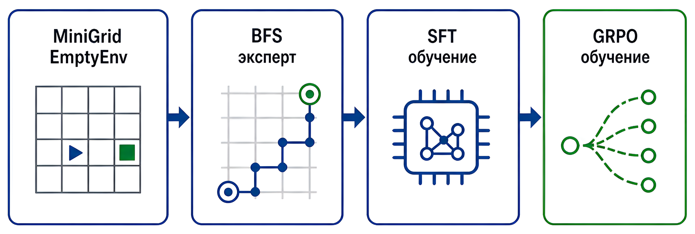
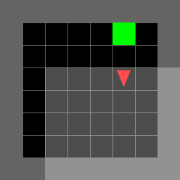
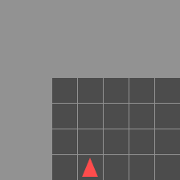
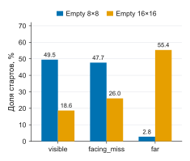
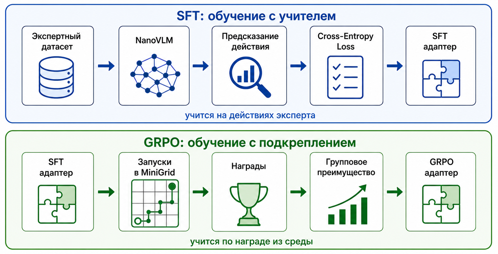
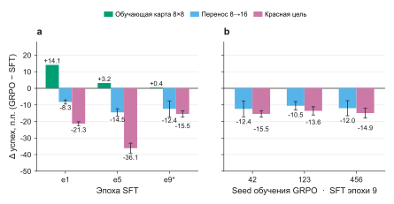
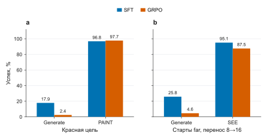
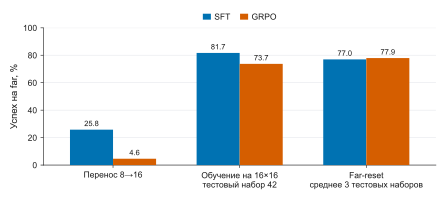
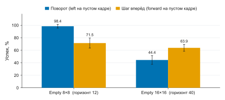

# When GRPO Generalizes Worse Than SFT


[](https://huggingface.co/romplle/grpo-vs-sft-ood-adapters)

## Описание проекта

В проекте NanoVLM дообучается выбирать действие в MiniGrid Empty. Агент видит частичный эгоцентричный обзор 7×7 клеток в виде RGB-картинки и выбирает `left`, `right` или `forward`.

Сначала политика учится на траекториях BFS-эксперта (SFT), затем второй LoRA-адаптер дообучается методом GRPO по награде среды. Оба этапа описаны в разделе [«Стенд»](#стенд).

Сравниваются SFT и GRPO. Тезис Chu et al. [1] «SFT запоминает, RL обобщает» на этом стенде не подтверждается. Знак Δ = GRPO − SFT зависит от теста. На Empty 8×8 с зелёной целью, где шло обучение, GRPO не хуже SFT. На переносе 8→16 и на красной цели GRPO обобщает хуже: доля успешных эпизодов меньше, потому что награду обучения можно получить, так и не научившись тому, что проверяют эти тесты. Ни карты 16×16, ни красной цели в обучении нет; дальше эти тесты названы OOD (out-of-distribution), а обучающая карта — in-domain.

Дальше разобраны три части результата: сам знак, два механизма провалов на OOD и правило, по которому ожидаемый знак читается из награды обучения ([«Когда GRPO лучше SFT, а когда хуже»](#когда-grpo-лучше-sft-а-когда-хуже)).

Основные цифры сняты декодером `generate` на горизонтах **12** шагов для 8×8 и **40** для 16×16, по 250 эпизодов на каждом из трёх тестовых наборов (seed 42, 123, 456). SFT — эпоха 9 длинного обучения на 8×8; где используется другой SFT, это сказано явно.

Общая схема pipeline:



## Оглавление

1. [Стенд](#стенд)
2. [Главный результат](#главный-результат)
3. [Два механизма](#два-механизма)
4. [Почему на переносе SFT лучше](#почему-на-переносе-sft-лучше)
5. [Когда GRPO лучше SFT, а когда хуже](#когда-grpo-лучше-sft-а-когда-хуже)
6. [Ограничения](#ограничения)
7. [Запуск](#запуск)
8. [Литература](#литература)

## Стенд

По периметру стены, внутри пустые клетки, одна клетка — цель. Агент не видит полную карту. Эпизод успешен, когда агент встаёт на клетку цели. Награда MiniGrid равна `1 − 0.9 · t / max_steps`, где `t` — число потраченных шагов: короткий путь даёт больше.

| Полный вид 8×8 | Вид агента |
|---|---|
|  |  |

Три типа старта, по которым разбирается success rate:

| Старт | Что видит агент |
|---|---|
| `visible` | Цель уже в кадре |
| `facing_miss` | Цели в кадре нет; один–три поворота на месте выводят её в кадр |
| `far` | Цель не видна ни при одном из четырёх направлений на этой клетке. Чтобы её увидеть, нужно сменить позицию |

На 8×8 доля `far` около 3% стартов (2.8%), на 16×16 — около 55%. Действия те же, доля дальних стартов другая.



Модель — [NanoVLM v0.1](https://github.com/huggingface/nanoVLM/releases/tag/v0.1), около 222M параметров, дообучение LoRA. Формат входа:

```text
User: <image>
{prompt}
Assistant:
```

Промпт обучения просит дойти до зелёной клетки. Ответ — один токен с ведущим пробелом: ` left`, ` right` или ` forward`.

Два этапа обучения:

1. **SFT.** Эксперт — BFS по полной позе (координаты, направление, положение цели). Политика этого состояния не видит. Обучение — кросс-энтропия по действию эксперта на текущем кадре.
2. **GRPO.** Второй LoRA поверх SFT. С одного и того же начального состояния — где стоит агент, куда он смотрит и где цель — разыгрывается группа из 16 эпизодов. Действия эпизодов с наградой выше среднего по группе становятся вероятнее, ниже среднего — менее вероятными. Если все 16 эпизодов закончились одинаково, преимущество у всех равно нулю, и от шага остаётся только член KL.

Розыгрыш эпизодов в GRPO и оценка в среде используют один декодер `generate`: модель семплирует один токен из полного словаря. SFT учится на действиях эксперта; семплирование появляется только в GRPO и на оценке. Токен вне трёх действий завершает эпизод. Для обновления GRPO из тех же логитов берутся только три токена действий. Клип PPO здесь шаг не меняет: на каждый розыгрыш делается одно обновление, dropout LoRA равен нулю, поэтому отношение новой и старой вероятности равно 1. По сути это REINFORCE с групповым baseline и KL-штрафом к SFT. На оценке GRPO загружается вместе с родительским SFT.

Сравнение этапов:



## Главный результат

Δ = GRPO − SFT в процентных пунктах. Положительное значение значит, что по доле успешных эпизодов GRPO лучше SFT.

В таблице SFT эпохи 9 и GRPO, обученный поверх него три раза с разным seed (42, 123, 456). GRPO — среднее трёх обучений, ± — стандартное отклонение Δ по ним.

| Где меряем | SFT | GRPO | Δ |
|---|---:|---:|---:|
| Empty 8×8, зелёная цель (обучающая карта) | 97.87% | 98.27% | **+0.40** ± 0.23 |
| Перенос: те же веса на карте 16×16 | 57.47% | 45.82% | **−11.64** ± 0.98 |
| Красная цель на 8×8 | 17.87% | 3.20% | **−14.67** ± 0.96 |

Все три обучения дают отрицательный знак на обоих OOD-тестах. Механизмы ниже разобраны на одном из них (seed 42): перенос 45.07% (Δ −12.40), красная цель 2.40% (Δ −15.47).



Слева — Δ по эпохам SFT для обучения GRPO seed 42. В клетке обучающей карты у эпохи 9 стоит среднее трёх обучений, отсюда звёздочка `e9*`. Справа — оба OOD-теста для каждого из трёх обучений. Усы — стандартное отклонение по трём тестовым наборам.

Отрицательный знак на OOD есть уже после первой эпохи SFT, когда прирост GRPO на обучающей карте максимален: **+14.1** п.п. на обучающей карте, **−8.3** на переносе и **−21.3** на красной цели.

Из измеренных эпох SFT (1, 5 и 9) лучшая на обоих OOD-тестах — пятая: перенос 59.87% против 57.47% у эпохи 9, красная цель 40.27% против 17.87%. Больше половины падения SFT на красной цели (−13.3 из −22.4 п.п.) приходится на старты, где красная клетка уже в кадре: успех на них 48.64% → 21.32% (в среднем 122 таких старта из 250).

Вывод: GRPO усиливает поведение, которым на обучении уже берётся награда. На 8×8 это движение к зелёной клетке и поворот на пустом кадре. Навык, нужный на большой карте и при другом цвете цели, в эту награду почти не входит.

## Два механизма

### Перенос: политика реже начинает поиск

Здесь и в следующем подразделе — обучение GRPO seed 42, проверка на карте 16×16. В таблице доля успешных эпизодов среди стартов данного типа (типы описаны в разделе «Стенд»), среднее по трём тестовым наборам. Из 250 эпизодов на одном наборе цель сразу видна в 41–57, поворот на месте нужен в 62–67, дальних стартов 131–144.

| Старт на переносе 8→16 | SFT | GRPO |
|---|---:|---:|
| `visible` | 99.42% | 95.88% |
| `facing_miss` | 95.22% | 95.82% |
| `far` | **25.81%** | **4.61%** |

Когда цель уже в кадре или её показывает поворот на месте, обе политики доходят примерно в 96–99% случаев. Разница переноса сидит в строке `far`: чтобы увидеть цель, надо сойти с клетки, и здесь SFT доходит в 25.81% эпизодов, а GRPO — в 4.61%.

Среди неуспешных эпизодов с пустым стартовым кадром GRPO в 71–81% случаев только поворачивается и ни разу не сходит с клетки. У SFT таких эпизодов 20–26% (диапазон по тестовым наборам).

Проверка SEE. Оракул доводит агента до позы, где цель уже в кадре, дальше действует обычный `generate`. На `far` GRPO поднимается с **4.61%** до **87.54%**. Значит, к видимой цели GRPO идёт, а ломается именно поиск. Восстановление неполное: под тем же оракулом SFT даёт 95.09%. На двух других обучениях GRPO картина та же: 5.51% → 93.74% и 4.62% → 77.01%.



На рисунке столбец Generate — обычная оценка, без оракула SEE и без перекраски PAINT.

Почему поиск почти не попадает в обновление. Каждый шаг GRPO — одна группа из 16 эпизодов с одного и того же начального состояния; в трёх обучениях эпохи 9 вместе 300 групп. Старты `far` встретились в них **12 раз**. В 10 группах из 12 исходы внутри группы различались, и обновление ненулевое; в двух оно нулевое. Главное здесь — редкость таких групп, а не нулевые обновления.

Если обучать сразу на 16×16, где `far` — больше половины стартов, падения до 4.61% нет. Здесь другой SFT — обученный на 16×16, эпоха 8 того же длинного обучения, — и три обучения GRPO поверх него.

В таблице только дальние старты. Строка — один тестовый набор, одни и те же начальные состояния во всех столбцах. **Far SFT** — доля успешных дальних эпизодов у этого SFT. **Far GRPO** — то же самое, среднее трёх обучений GRPO. **Δ** = GRPO − SFT в процентных пунктах: на наборе 42 это 73.71 − 81.69 = −7.98. **95% интервал** показывает, насколько эта разность могла сдвинуться из-за конечного числа эпизодов. Он посчитан по тем же стартам, парами «успех SFT / успех GRPO». Интервал целиком ниже нуля значит, что на этом наборе GRPO хуже SFT. Ноль внутри интервала значит, что знак по этому набору не установлен.

| Тестовый набор | Far SFT | Far GRPO | Δ | 95% интервал Δ |
|---|---:|---:|---:|---|
| 42 | 81.69% | 73.71% | **−7.98** | [−15.26; −0.47] |
| 123 | 79.86% | 77.55% | **−2.31** | [−9.03; 4.63] |
| 456 | 69.47% | 72.26% | **+2.80** | [−5.60; 11.45] |

Знак здесь неустойчив: на наборе 42 GRPO хуже SFT и интервал целиком отрицательный, на наборах 123 и 456 интервал накрывает ноль. Три Δ не усредняются.



Три группы на рисунке — успех только на стартах `far`.

- **Перенос 8→16:** обучение на 8×8, проверка на 16×16 (SFT 25.81%, GRPO 4.61%).
- **Обучение на 16×16:** тестовый набор 42, GRPO — среднее трёх обучений (73.71% против 81.69% у SFT).
- **Far-reset:** одно обучение GRPO (seed 42) на 16×16, где каждый эпизод начинался с дальнего старта. Столбцы — среднее по трём тестовым наборам: GRPO 77.94%, SFT 77.01%, то есть на уровне SFT. 77.01% — тот же SFT 16×16, усреднённый по трём наборам; из 73.71% его вычитать нельзя, это клетки разных наборов.

Вывод: на переносе GRPO ослабляет поиск, потому что на 8×8 поиск почти не нужен для награды. Когда дальние старты есть в обучении, провала до 4.61% нет, но и устойчивого выигрыша GRPO над SFT тоже нет.

### Красная цель: награда совпадает с зелёными пикселями

На обучении цель всегда зелёная, и промпт просит дойти до зелёной клетки.

Тест с красной целью — та же карта и те же начальные состояния. Зелёная клетка цели заменяется красной. В промпте слово green заменено на red. Для GRPO seed 42 успех на этом тесте **2.40%**, у SFT — 17.87% (в таблице выше 3.20% — среднее трёх обучений GRPO).

Проверка PAINT берёт эти же эпизоды. Промпт по-прежнему просит red, среда и награда прежние, но в кадре агента пиксели клетки цели перекрашены в зелёный. GRPO поднимается с **2.40%** до **97.73%**, SFT — с 17.87% до 96.80%. На двух других обучениях GRPO: 97.60% и 98.13%. Обратный прогон оставляет клетку красной и пишет в промпте green: успех **3.33%**, почти как 2.40% при красном тексте. Политика идёт на зелёный цвет в кадре, а не на слово в промпте.

Отдельно обучен один GRPO (seed 42): в каждом эпизоде цель с равной вероятностью зелёная или красная, и промпт называет тот же цвет. На красном тесте успех поднимается до **54.40%** (против 2.40%). На зелёной обучающей карте он падает до **94.40%**, хуже SFT (97.87%). Цвет цели в обучении на результат влияет, но до уровня зелёной цели политика не доходит.

Вывод: в этой постановке цвет клетки и есть цель. У Chu et al. [1] цвет карт на награду не влияет, и там RL обобщает лучше SFT (таблица ниже). Здесь цвет входит в награду, и GRPO обобщает хуже.

## Почему на переносе SFT лучше

Эксперт видит скрытую цель. На 8×8 почти все пустые кадры относятся к `facing_miss`: цель рядом, и эксперт поворачивается. На редких дальних кадрах он идёт вперёд, и пошаговый SFT сохраняет часть этого поведения. GRPO оценивает успех всего эпизода при случайном старте: редкий шаг вперёд почти не повышает награду, и политика чаще выбирает поворот.

На 16×16 большая часть пустых кадров — `far`, и эксперт на них чаще делает `forward`. SFT, обученный сразу на 16×16, видит это действие с начала обучения. Перенос с 8×8 этого распределения не получает.

Ту же развилку можно проверить без нейросети, двумя программами с фиксированными действиями. На рисунке — доля успешных эпизодов, среднее по тем же трём тестовым наборам. Усы — 95% интервал. Когда цель уже в кадре, обе идут к ней кратчайшим путём. На пустом кадре «Поворот» всегда делает `left`, «Шаг вперёд» всегда делает `forward`.



На 8×8 почти всегда достаточно повернуться, поэтому поворот доходит примерно в 98% эпизодов, а шаг вперёд — в 71%. На 16×16 цель чаще не открывается поворотом: поворот падает примерно до 44%, шаг вперёд — примерно до 64%. На каждой карте лучше своя программа, и усы на одной карте не пересекаются.

Успех GRPO на переносе (~45%) близок к политике поворота на 16×16 (~44%), но это не одна и та же политика. По типам старта поворот даёт 100% / 100% / 0%, GRPO — 95.88% / 95.82% / 4.61% (`visible` / `facing_miss` / `far`). Суммы совпадают за счёт компенсации: GRPO примерно на 4 п.п. хуже поворота на первых двух типах и на 4.6 п.п. лучше на `far`. Красную цель этот расчёт не объясняет: для неё нужна проверка PAINT.

Вывод: остаток SFT на переносе согласуется с тем, что SFT учился пошагово на траекториях эксперта, который видит скрытую цель.

## Когда GRPO лучше SFT, а когда хуже

Смотрим, можно ли на обучающих эпизодах получать награду, так и не научившись тому, что проверяет тест. Если нельзя, этот навык приходится выучить, и ожидаем, что GRPO будет не хуже SFT. Самих процентов правило не даёт. Если можно, GRPO закрепляет более лёгкий способ. На тесте, где этого способа нет, GRPO оказывается хуже SFT: у SFT ещё остаются действия эксперта.

Это эвристика, а не теорема: она проверена на случаях из таблицы ниже, и последний из них совпадает с ней лишь частично.

На этом стенде лёгкий способ есть. На 8×8 награда берётся поворотом к зелёной клетке: поиск на большой карте и красная цель для неё не нужны. Когда дальние старты сами входят в обучение, как на 16×16, провала до 4.61% нет. Так читается ожидаемый знак. Проценты успеха из этого чтения не выводятся.

| Работа | Можно ли на обучении получить награду, не научившись тому, что проверяет тест? | Что выходит |
|---|---|---|
| Chu et al. [1], карты другого цвета; награда — собрать 24 | Нет. Цвет на награду не влияет | RL лучше SFT |
| Lu et al. [2], картинки другого стиля (ImageNet-R) | Нет. Награда — верный класс | RL лучше SFT |
| Visionary-R1 [3], сложные вопросы с картинкой | Да. На лёгких вопросах хватает текста | GRPO обходится без картинки |
| Эта работа, красная цель | Да. Хватает зелёной клетки | GRPO хуже SFT |
| Эта работа, поиск при переносе 8→16 | Да. На 8×8 хватает поворота | GRPO хуже SFT |
| Эта работа, дальние старты при обучении на 16×16 | Нет. Такие старты в обучении есть | Провала нет, но знак неустойчив: −7.98 / −2.31 / +2.80 по трём наборам |

Что из этого можно взять в другой работе:

- Перед утверждением «RL обобщит лучше SFT» стоит проверить, можно ли на обучении получить награду, не научившись тому, что проверяет тест. Если можно, лозунг не обязан выполняться.
- Если провал уже есть, два приёма отделяют причину. Оракул, который сам показывает цель, отличает «не ходит» от «не начинает искать». Перекраска клетки при прежнем промпте отличает «слушает текст» от «идёт на цвет пикселя».

## Ограничения

- Одна базовая модель (NanoVLM, 222M) и одно семейство сред (MiniGrid Empty).
- Три обучения GRPO на каждую конфигурацию, все поверх одного SFT. Far-reset и смешанный цвет обучены по одному разу.

## Запуск

1. Клонируйте репозиторий и установите зависимости: `pip install -r requirements.txt`. Нужен Python 3.11 или новее; PyTorch ставится в сборке CUDA 13.2 с индекса, указанного в файле.
2. Скачайте [NanoVLM v0.1](https://github.com/huggingface/nanoVLM/releases/tag/v0.1) и положите папку в корень под именем `nanoVLM`. Веса базовой модели скачиваются с Hugging Face Hub при первом запуске.
3. Если `wandb` не нужен, добавьте `--no-wandb` к командам обучения.
4. Обученные LoRA-адаптеры, на которых сняты цифры, лежат в [romplle/grpo-vs-sft-ood-adapters](https://huggingface.co/romplle/grpo-vs-sft-ood-adapters). `hf download romplle/grpo-vs-sft-ood-adapters --local-dir checkpoints` раскладывает их по тем же путям, что в командах ниже.

Датасеты эксперта:

```powershell
python scripts/dataset_generation.py --env-size 8 --save-path datasets/dataset_8x8
python scripts/dataset_generation.py --env-size 16 --save-path datasets/dataset_16x16
```

Обучение SFT на 10 эпох и GRPO поверх эпохи 9. У `grpo.py` значения по умолчанию для `--lr`, `--epsilon`, `--beta` и `--lora-dropout` отличаются от тех, на которых сняты цифры, поэтому они переданы явно. Существующие каталоги в `checkpoints/` не перезаписывать: каждое новое обучение — в новый `--output-dir`.

```powershell
python scripts/sft.py --env-size 8 --dataset-path datasets/dataset_8x8 --output-dir checkpoints/sft_adapter_8x8_bs32_e10 --epochs 10 --early-stop-patience 2
python scripts/grpo.py --env-size 8 --dataset-path datasets/dataset_8x8 --sft-adapter-path checkpoints/sft_adapter_8x8_bs32_e10/epoch-9 --output-dir checkpoints/grpo_adapter_8x8_handoff_from_e10_e9 --lr 5e-6 --epsilon 0.1 --beta 0.1 --lora-dropout 0.0 --episodes 100 --seed 42
```

Оценка одного обучения на одном тестовом наборе: 250 эпизодов, `--seed 42`. Горизонт по умолчанию совпадает с таблицами: **12** на 8×8 и **40** на 16×16; в командах он всё равно передан явно. Числа в таблицах — среднее трёх тестовых наборов (seed 42, 123 и 456), а для GRPO ещё и среднее трёх обучений.

```powershell
# Empty 8×8, зелёная цель
python scripts/test_models.py --env-size 8 --dataset-path datasets/dataset_8x8 --sft-adapter-path checkpoints/sft_adapter_8x8_bs32_e10/epoch-9 --grpo-adapter-path checkpoints/grpo_adapter_8x8_handoff_from_e10_e9/episode-100 --episodes 250 --seed 42 --max-steps 12

# Те же веса 8×8 на карте 16×16
python scripts/test_models.py --env-size 16 --dataset-path datasets/dataset_16x16 --sft-adapter-path checkpoints/sft_adapter_8x8_bs32_e10/epoch-9 --grpo-adapter-path checkpoints/grpo_adapter_8x8_handoff_from_e10_e9/episode-100 --episodes 250 --seed 42 --max-steps 40

# Те же веса, красная цель
python scripts/test_models.py --env-size 8 --dataset-path datasets/dataset_8x8 --sft-adapter-path checkpoints/sft_adapter_8x8_bs32_e10/epoch-9 --grpo-adapter-path checkpoints/grpo_adapter_8x8_handoff_from_e10_e9/episode-100 --episodes 250 --seed 42 --max-steps 12 --goal-color red --prompt-goal-color red
```

Повторное обучение даст близкие, но не побитово совпадающие числа: розыгрыш семплирует на GPU, а часть исторических запусков шла на более ранней версии кода. Обучения far-reset и со смешанным цветом цели в этой ветке не воспроизводятся: флагов для них в `scripts/grpo.py` нет.

Флаги скриптов: `python scripts/<name>.py --help`.

```text
grpo-vs-sft-ood/
├── checkpoints/          # не в git: адаптеры скачиваются с Hugging Face Hub (п. 4 «Запуска»)
├── datasets/             # экспертные датасеты 8x8 и 16x16
├── docs/figures/         # виды среды и схема pipeline
├── notebooks/            # ноутбук для ручной проверки
├── scripts/              # обучение, оценка и измерения
├── src/vlm_minigrid_rl/  # библиотека Empty и измерения
├── tests/                # юнит-тесты
├── thesis/               # рисунки, данные к ним и сверка цифр
├── nanoVLM/              # внешний чекаут NanoVLM
├── RESEARCH.md           # протокол замеров и пути к чекпойнтам
├── requirements.txt
└── README.md
```

## Литература

1. Chu T. et al. SFT Memorizes, RL Generalizes: A Comparative Study of Foundation Model Post-training. [arXiv:2501.17161](https://arxiv.org/abs/2501.17161), 2025.
2. Lu A. et al. Why Does RL Generalize Better Than SFT? A Data-Centric Perspective on VLM Post-Training. [arXiv:2602.10815](https://arxiv.org/abs/2602.10815), 2026.
3. Xia J. et al. Visionary-R1: Mitigating Shortcuts in Visual Reasoning with Reinforcement Learning. [arXiv:2505.14677](https://arxiv.org/abs/2505.14677), 2025.
